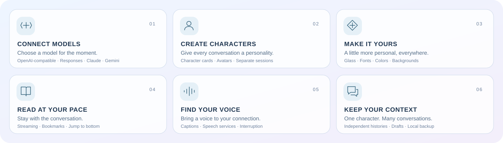

<p align="center">
  <a href="https://skymoni.com/skivu/"></a>
</p>

<div align="center">
  <p><strong>Open-source AI chat. Your models, your characters, your style.</strong></p>
  <p><a href="README.md">简体中文</a> · <strong>English</strong></p>
  <p>
    <a href="https://skymoni.com/skivu/">Explore the website</a> ·
    <a href="https://github.com/skyjjgw/skivu/releases/latest">Download Android</a> ·
    <a href="https://skymoni.com/creators/skivu-beta">Beta program</a> ·
    <a href="https://skymoni.com/creators">Community</a> ·
    <a href="https://github.com/skyjjgw/skivu-plugins">Plugin community</a>
  </p>
  <p>
    <a href="https://github.com/skyjjgw/skivu/releases/latest"></a>
    
    <a href="pubspec.yaml"></a>
    <a href="LICENSE"></a>
  </p>
</div>

Skivu brings model connections, character-based conversations and personal appearance settings into one mobile app. Connect your own model API or sign in with a Skymoni account to synchronize available models and quotas. Each character can have several conversations with separate histories, context and drafts.

**Android is the primary release platform.** The same Flutter source also provides a mobile-layout Web preview. This repository contains the app; the website, service and plugin community have their own entry points below.

## A look inside

| Conversations | Characters & sessions | Appearance |
| :---: | :---: | :---: |
|  |  |  |

Actual Android app screens using local demo content, shown with the Chinese UI. The website's interactive concepts and brand film are separate product presentations.

## Make it yours

<picture>
  <source media="(max-width: 600px)" srcset="docs/images/skivu-features-mobile.svg">
  
</picture>

<details>
<summary><strong>Explore features and supported model protocols</strong></summary>

| Area | What you can do |
| --- | --- |
| Model connections | Use OpenAI-compatible Chat Completions, Responses, Claude Messages or Gemini Generate Content. Search and switch models from the composer. |
| Characters & sessions | Customize avatars, character settings and prompts. Share a character card across independent conversations; search, rename and pin sessions. |
| Glass & layout | Adjust blur, transparency, the top bar and bubble styles. Choose centered, side-width or full-width reply layouts. |
| Personal appearance | Set fonts and colors independently for the interface, composer, user messages, character replies and thinking text. Import fonts and use image or video backgrounds. |
| Reading & navigation | Smooth streamed text, expandable thinking sections, message navigation dial, bookmarks and a jump-to-bottom action. Stop, retry or confirm deletion of a conversation round. |
| Voice | A water-drop orb call interface with captions, mute and interruption; Android system speech and configurable cloud text-to-speech connections. |
| Accounts & updates | In-app login, model and quota synchronization, account switching and update checks. Packages are verified before Android asks you to confirm installation. |

</details>

Attachments, plugin execution and the right-side workspace are not available yet. Their app entries are marked **Coming soon**.

## The Skivu ecosystem

<table>
  <tr>
    <td width="50%"><strong><a href="https://skymoni.com/skivu/">01 / Product website</a></strong><p>Meet the app, explore interactive showcases and watch the <a href="https://skymoni.com/skivu/#brand-film">brand film</a>.</p></td>
    <td width="50%"><strong><a href="https://skymoni.com/creators/skivu-beta">02 / Beta center</a></strong><p>Apply for account-based beta access and view your status and allocated quota.</p></td>
  </tr>
  <tr>
    <td><strong><a href="https://skymoni.com/creators">03 / Community</a></strong><p>Share experiences and character prompts, discuss features and create together.</p></td>
    <td><strong><a href="https://github.com/skyjjgw/skivu-plugins">04 / Plugin community</a></strong><p>Draft specifications, content-pack templates, examples and a preview catalog.</p></td>
  </tr>
  <tr>
    <td><strong><a href="https://skymoni.com/">05 / Skymoni service</a></strong><p>Optional account and model-service access. Your own model API is also supported.</p></td>
    <td><strong><a href="https://github.com/skyjjgw/skymoni-source">06 / Website &amp; service source</a></strong><p>Source releases, version records and license notices for the related service.</p></td>
  </tr>
</table>

## Download & beta access

Download the APK from **[the latest GitHub release](https://github.com/skyjjgw/skivu/releases/latest)**. Existing users can also use **Settings → Check for updates** in the app. Release notes include the version, matching source, file size and SHA-256.

| Requirement | Supported |
| --- | --- |
| Android | 7.0 / API 24 or later |
| Architectures | `arm64-v8a` and `x86_64`, included in the Universal APK |
| Application ID | `com.skyjjgw.independent.ski` |

The APK is publicly downloadable. **Beta quota requires a separate application and approval** through the [beta center](https://skymoni.com/creators/skivu-beta):

1. Sign in with your Skymoni community account and submit an application.
2. After approval, the administrator allocates a separate app-beta quota.
3. Sign in with the same account inside Skivu to synchronize your access, models and balance.

Beta quota is managed separately from the service wallet and subscriptions. An unavailable or exhausted beta balance does not automatically fall back to charging the wallet. You can also configure your own model API without joining the beta program.

Current beta APKs retain the existing development signing certificate for compatible upgrades. A locally built APK signed with a different certificate cannot replace the distributed app. Configure your own release signing for independent distribution.

## Getting started

1. **Connect a model.** Use **Settings → Skymoni account**, or add your endpoint, key, protocol and model under **Models & services**. Available models and billing depend on the selected service; no shared API key or model credits are bundled.
2. **Create a character.** Set an avatar, description, personality, scenario, relationship, example dialogue and greeting. Tap an avatar in chat to edit the character card or your own identity card.
3. **Start a conversation.** The top sidebar action asks you to choose a character; the action within a character creates a session already bound to that character. Context, history and drafts remain separate between sessions.
4. **Make it yours.** Use **Settings → Appearance & experience** to adjust text, backgrounds, glass and layouts. Speech connections are configured separately under **Voice & calls**.

Text-to-speech supports Android system TTS, OpenAI-compatible services, ElevenLabs, Azure and custom HTTP endpoints. Speech recognition depends on Android speech services and language packs. See the [API integration notes](API-INTEGRATION-SOURCES.md) for configuration scope; these technical notes are currently in Chinese.

## Plugin community

[Skivu Plugins](https://github.com/skyjjgw/skivu-plugins) is open for community development. It currently provides a `0.1-draft` specification for plain-text prompt packs, JSON schemas, a template, an example and local validation tools. The community catalog is a **preview catalog** with `runtimeReady: false`.

**The released app does not yet load, install, execute or update plugins.** Its plugin-market entry remains “Coming soon”. You can contribute proposals and content packages through the repository's review process.

[Development guide](https://github.com/skyjjgw/skivu-plugins/blob/main/docs/development.md) · [Template](https://github.com/skyjjgw/skivu-plugins/tree/main/templates/prompt-pack) · [Catalog specification](https://github.com/skyjjgw/skivu-plugins/blob/main/docs/catalog.md) · [Submit a package](https://github.com/skyjjgw/skivu-plugins/blob/main/CONTRIBUTING.md) · [Roadmap](https://github.com/skyjjgw/skivu-plugins/blob/main/docs/roadmap.md)

## Development & contributions

Development baseline: **Flutter 3.41.9 / Dart 3.11.5**, Android SDK and JDK 17. The Dart constraint is recorded in [pubspec.yaml](pubspec.yaml).

<details>
<summary><strong>Run, check and build from source</strong></summary>

```sh
git clone https://github.com/skyjjgw/skivu.git
cd skivu
flutter pub get
flutter devices
flutter run -d <android-device-id>
```

```sh
# Mobile-layout Web preview
flutter run -d chrome

# Checks
flutter analyze
flutter test

# Universal Android APK
flutter build apk --release --target-platform android-arm64,android-x64
```

The APK is written to `build/app/outputs/flutter-apk/app-release.apk`.

</details>

- **App bugs and features:** use [Skivu Issues](https://github.com/skyjjgw/skivu/issues). Include the app version, Android version, device, reproduction steps and relevant screenshots.
- **Code and documentation:** submit a focused [pull request](https://github.com/skyjjgw/skivu/pulls) with its purpose and validation. Check Android UI changes on a device or emulator.
- **Plugin packages and specifications:** use [Skivu Plugins](https://github.com/skyjjgw/skivu-plugins) and its contribution guide.
- **Experiences and character prompts:** share them in the [community](https://skymoni.com/creators). Remove credentials and private chat content from anything you publish.

## Data & privacy

- Chat history, characters, drafts and appearance settings are stored locally. Chat data supports backup and restore.
- API keys, account sessions and speech connection credentials are stored separately with `flutter_secure_storage` and excluded from chat backups. The app does not persist account login passwords.
- Sending a message transmits the relevant conversation and character settings to the selected model provider. Cloud TTS receives text to synthesize; system speech recognition may also use network services.
- Android and browser data are separate. Web API connections depend on the provider's CORS policy; native Android speech and package installation are not Web-preview capabilities.

## Documentation & license

The following technical documents are currently in Chinese:

| Document | Scope |
| --- | --- |
| [Accounts & updates](APP-ACCOUNT-UPDATES.md) | Login, model and quota synchronization, update verification |
| [API integration](API-INTEGRATION-SOURCES.md) | Model and speech protocols, sources and compatibility |
| [Module provenance](MODULE-MIGRATION.md) | Message navigation and call-interface migration scope |
| [Water-drop orb provenance](ORB-PROVENANCE.txt) | Drawing component and Shader source records |
| [Third-party notices](THIRD_PARTY_NOTICES.md) | Dependencies, fonts and distribution notices |

Original project code is licensed under **GNU General Public License v3.0 only (GPL-3.0-only)**; see [LICENSE](LICENSE) and [COPYRIGHT](COPYRIGHT). Third-party components and fonts retain their own licenses, included in [licenses/](licenses/). Independent plugins retain the licenses declared by their authors.

The glass interface uses **Liquid Glass Easy** (MIT). Bundled fonts include **Noto Sans SC, Noto Serif SC and Roboto Mono**. Thank you to the open-source projects and contributors behind them.
