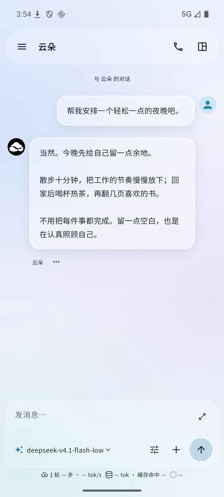
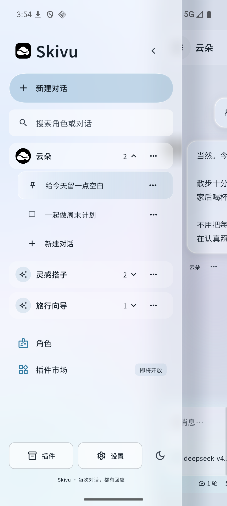
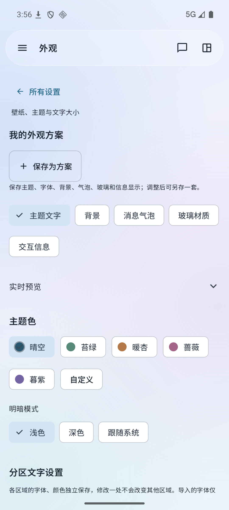
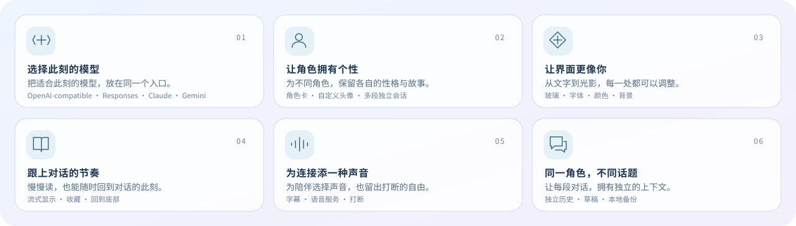

<p align="center">
  <a href="https://skymoni.com/skivu/"></a>
</p>

<div align="center">
  <p><strong>开源的多模型聊天应用，让对话、角色和界面更像你。</strong></p>
  <p><strong>简体中文</strong> · <a href="README.en.md">English</a></p>
  <p>
    <a href="https://skymoni.com/skivu/">探索官网</a> ·
    <a href="https://github.com/skyjjgw/skivu/releases/latest">下载 Android</a> ·
    <a href="https://skymoni.com/creators/skivu-beta">申请内测</a> ·
    <a href="https://skymoni.com/creators">交流社区</a> ·
    <a href="https://github.com/skyjjgw/skivu-plugins">插件共创</a>
  </p>
  <p>
    <a href="https://github.com/skyjjgw/skivu/releases/latest"></a>
    
    <a href="pubspec.yaml"></a>
    <a href="LICENSE"></a>
  </p>
</div>

Skivu 将模型连接、角色陪伴与外观定制放进同一个手机空间。你可以连接自己的模型 API，也可以使用 Skymoni 账号同步可用模型和额度；为同一个角色开启不同话题，各段对话独立保存历史、上下文与草稿。

**Android 是当前主要发布平台**，同一套 Flutter 源码也提供 Web 手机界面预览。这里维护 App 源码；产品官网、内测中心、社区与插件共创各有独立入口。

## 从一次对话开始

| 对话空间 | 角色与会话 | 外观随心 |
| :---: | :---: | :---: |
|  |  |  |

截图来自 Android App，使用本地演示内容。官网中的交互概念与品牌宣传片属于独立的产品展示。

## 按你的方式使用

<picture>
  <source media="(max-width: 600px)" srcset="docs/images/skivu-features-mobile-zh.svg">
  
</picture>

<details>
<summary><strong>展开查看功能与接口支持</strong></summary>

- **模型连接**：OpenAI 兼容 Chat Completions、Responses、Claude Messages、Gemini Generate Content；在输入框直接搜索和切换模型，设置输出长度、流式与上下文。
- **角色会话**：自定义头像、角色卡和提示词；同一角色可拥有多段独立对话，支持搜索、重命名、置顶与重启恢复。
- **玻璃与版式**：调整模糊、透明度、顶栏与气泡样式；角色回复可选择居中、铺满一侧或全屏阅读布局。
- **分区外观**：界面、输入框、我的消息、角色回复、思考过程分别配置字体和颜色；支持导入字体、图片／视频背景和外观方案。
- **消息阅读**：平滑流式显示、可展开的思考区域、消息导航拨盘、收藏和回到底部；支持停止、重试与确认删除单轮对话。
- **语音通话**：水滴光球、字幕、静音与打断；语音合成支持系统、OpenAI 兼容、ElevenLabs、Azure 和自定义 HTTP。识别依赖 Android 系统语音服务及语言包。
- **账号与更新**：App 内登录、模型与额度同步、账号切换；校验 APK 摘要、大小、包名、版本及签名后，由 Android 系统确认安装。

</details>

附件上传、插件执行及右侧工作区尚未开放，App 中相关入口显示 **“即将开放”**。模型和语音服务的可用功能及计费取决于所选服务，仓库不附带共享 API Key 或模型额度。

## Skivu 生态与入口

<table>
  <tr>
    <td width="50%"><strong><a href="https://skymoni.com/skivu/">01 / 产品官网</a></strong><p>了解产品、体验交互展示，观看 <a href="https://skymoni.com/skivu/#brand-film">品牌宣传片</a>。</p></td>
    <td width="50%"><strong><a href="https://skymoni.com/creators/skivu-beta">02 / 内测中心</a></strong><p>提交内测申请，查看账号资格与管理员分配的专属额度。</p></td>
  </tr>
  <tr>
    <td><strong><a href="https://skymoni.com/creators">03 / 交流社区</a></strong><p>交流使用体验、分享角色提示词，参与功能讨论与作品共创。</p></td>
    <td><strong><a href="https://github.com/skyjjgw/skivu-plugins">04 / 插件共创</a></strong><p>开发规范、内容包模板、示例和社区收录目录，目前为规范预览阶段。</p></td>
  </tr>
  <tr>
    <td><strong><a href="https://skymoni.com/">05 / Skymoni 服务</a></strong><p>提供可选的账号与模型服务接入；也可在 App 配置自己的模型 API。</p></td>
    <td><strong><a href="https://github.com/skyjjgw/skymoni-source">06 / 网站与服务源码</a></strong><p>查看关联网站与服务的源码发布、版本记录及开源许可说明。</p></td>
  </tr>
</table>

## 下载与参与内测

在 **[GitHub 最新版本](https://github.com/skyjjgw/skivu/releases/latest)** 的 Assets 中下载 APK。已安装用户也可使用 **设置 → 检查更新**。每版发布说明记录版本、对应源码、文件大小和 SHA-256。

支持 **Android 7.0 / API 24 及以上**；Universal APK 包含 `arm64-v8a` 和 `x86_64`。应用标识为 `com.skyjjgw.independent.ski`。

APK 公开下载，**内测额度需要单独申请并获批准**：

1. 使用 Skymoni 社区账号进入 [内测中心](https://skymoni.com/creators/skivu-beta)，提交申请。
2. 审核通过后，由管理员手动分配独立的 App 内测额度。
3. 在 Skivu 内登录同一账号，同步资格、模型与额度。

内测额度与站内钱包／订阅分别管理；内测不可用或耗尽时，不会自动改扣钱包。自定义模型 API 接入也可独立使用。

当前内测安装包沿用既有开发签名，支持同签名覆盖升级。自行构建时若使用不同证书，不能直接覆盖已发布版本；独立分发请配置自己的发布签名。

## 开始使用

1. **连接模型**：在 **设置 → 中转站账号** 登录，或在 **模型与服务** 添加自己的地址、密钥、协议与模型并测试连接。
2. **创建角色**：填写头像、描述、性格、场景、关系、示例对话和开场白；点击聊天头像可编辑角色卡或自己的身份卡。
3. **开启话题**：侧栏顶部“新建对话”先选择角色，角色下的新建操作自动绑定该角色。不同会话的记录、上下文与草稿独立。
4. **调整体验**：在 **设置 → 外观与体验** 配置文字、背景、玻璃与消息版式；语音连接在 **语音与通话** 单独管理。

配置范围和协议说明见 [接口接入文档](API-INTEGRATION-SOURCES.md)。

## 插件共创

[Skivu Plugins](https://github.com/skyjjgw/skivu-plugins) 已开放社区参与，当前提供 `0.1-draft` 纯文本提示词内容包规范、JSON Schema、模板、示例和本地校验工具。收录目录为预览用途，`runtimeReady: false`。

**已发布 App 尚未接入插件加载、安装、执行和更新。** 插件市场入口仍显示“即将开放”；现在可以通过仓库提交提案、内容包与收录 PR。

[开发规范](https://github.com/skyjjgw/skivu-plugins/blob/main/docs/development.md) · [模板](https://github.com/skyjjgw/skivu-plugins/tree/main/templates/prompt-pack) · [目录规范](https://github.com/skyjjgw/skivu-plugins/blob/main/docs/catalog.md) · [提交收录](https://github.com/skyjjgw/skivu-plugins/blob/main/CONTRIBUTING.md) · [开放路线](https://github.com/skyjjgw/skivu-plugins/blob/main/docs/roadmap.md)

## 开发与贡献

开发基线为 **Flutter 3.41.9 / Dart 3.11.5**，Android 构建需要 Android SDK 和 JDK 17。Dart 约束见 [pubspec.yaml](pubspec.yaml)。

<details>
<summary><strong>从源码运行、检查与打包</strong></summary>

```sh
git clone https://github.com/skyjjgw/skivu.git
cd skivu
flutter pub get
flutter devices
flutter run -d <android-device-id>
```

```sh
# Web 手机界面预览
flutter run -d chrome

# 检查
flutter analyze
flutter test

# Universal Android APK
flutter build apk --release --target-platform android-arm64,android-x64
```

APK 输出到 `build/app/outputs/flutter-apk/app-release.apk`。Android 与浏览器的数据分别保存；Web 直连接口依赖服务端 CORS，原生语音与安装更新不属于 Web 预览能力。

</details>

- **App 问题与建议**：提交 [Issue](https://github.com/skyjjgw/skivu/issues)，附版本、Android 版本、设备、复现步骤及必要截图。
- **代码与文档**：提交范围清晰的 [Pull Request](https://github.com/skyjjgw/skivu/pulls)，说明目的与验证方式；手机界面改动需在 Android 设备或模拟器验证。
- **插件与规范**：在 [Skivu Plugins](https://github.com/skyjjgw/skivu-plugins) 按贡献指南参与。
- **使用体验与角色提示词**：欢迎在 [社区](https://skymoni.com/creators) 分享。公开前请移除凭据、会话令牌与私人聊天内容。

## 数据与隐私

聊天记录、角色、草稿和外观配置保存在本机，支持聊天数据备份与恢复。API 密钥、账号会话和语音连接凭据通过 `flutter_secure_storage` 单独保存，不进入聊天备份；App 不保存账号登录密码。

发起对话时，相关消息与角色设定会发送给所选模型服务。云端语音合成会发送待朗读文本，系统识别也可能联网。

## 文档与许可

[账号与更新](APP-ACCOUNT-UPDATES.md) · [接口接入](API-INTEGRATION-SOURCES.md) · [模块来源](MODULE-MIGRATION.md) · [光球来源](ORB-PROVENANCE.txt) · [第三方声明](THIRD_PARTY_NOTICES.md)

本项目原创代码采用 **GNU GPL v3.0 only（GPL-3.0-only）**，见 [LICENSE](LICENSE) 和 [COPYRIGHT](COPYRIGHT)。第三方组件、字体及独立插件保留各自许可证；随附声明见 [licenses/](licenses/)。

玻璃效果使用 **Liquid Glass Easy**（MIT），内置字体包括 **Noto Sans SC、Noto Serif SC、Roboto Mono**。感谢相关开源项目与贡献者。
