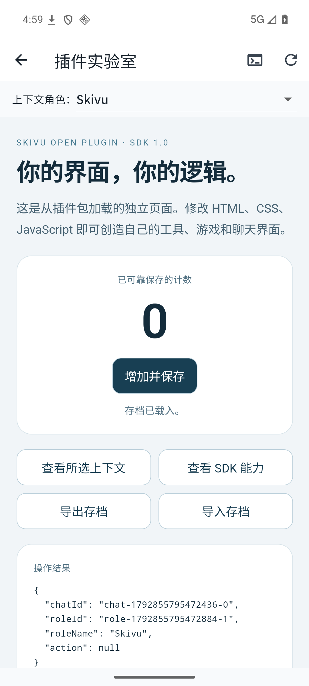
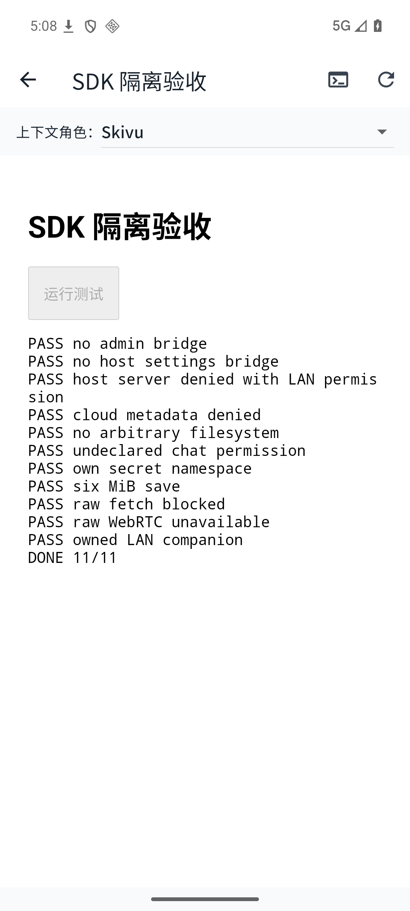

# SDK 1.0 验证记录

2026-10-25，基于 0.2.37+41 的原有社交 UI 和扩展能力增加开放运行时，版本 0.2.38+42。没有迁移、复制或内置第三方插件业务包；APK 仅带通用宿主和 SDK。

- 392 项 Flutter 回归通过（含 14 项开放插件测试），5 项 JavaScript SDK 测试通过，静态分析通过。
- 插件仓库 16 项检查通过，模板能确定性打包，完整可编辑源码和许可保留。
- Android API 36 模拟器中，从系统文件选择器导入独立包，确认来源/许可/权限后运行真实 HTML、CSS、ES module 和 SDK 桥；未使用共享模型或真实账号。
- 计数保存、重新加载恢复、文件导出后系统保存、导入恢复、任意聊天界面替换、聊天动作 action 传递经过实际 UI 验证。
- 隔离探针 11/11：无管理员桥、无宿主设置桥、即使获 LAN 权限仍拒绝宿主服务器、拒绝云元数据、拒绝工作区穿越、拒绝未声明聊天权限、自有密钥空间、6 MiB 原子存档、浏览器原始 fetch 被阻止、原始 WebRTC 不可用、用户自己的 loopback 辅助服务成功且未携带宿主 Authorization/Cookie。
- 模型生成使用模拟响应验证实际请求路径和保留身份材料；没有在设备上调用收费模型。没有做实体手机/OEM 专有验收。

本机辅助服务测试仅接收一次固定 JSON 请求，已结束；探针仅用于测试，不收录用户目录。真实模型、第三方服务账户和任意第三方插件仍需自己的功能验收，不能用 SDK 通过代替。

